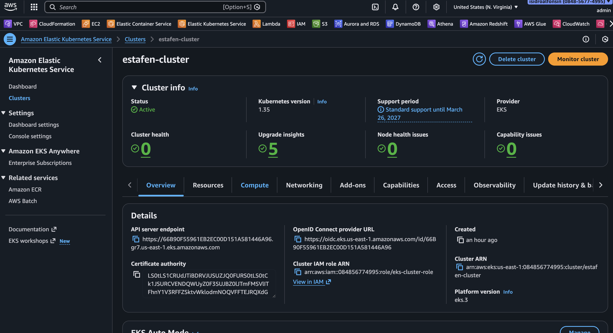
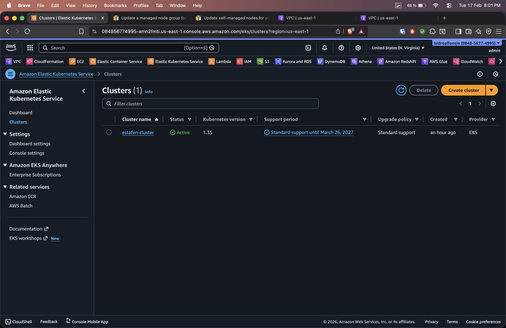
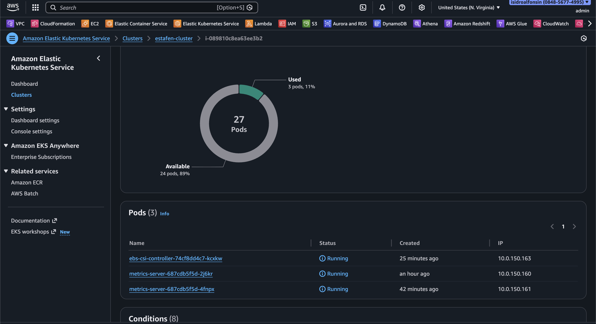
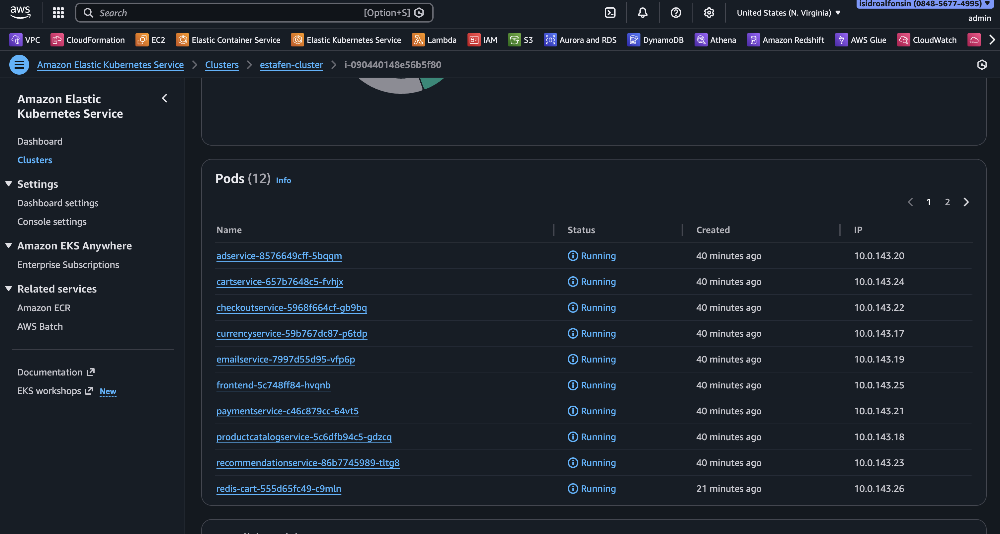
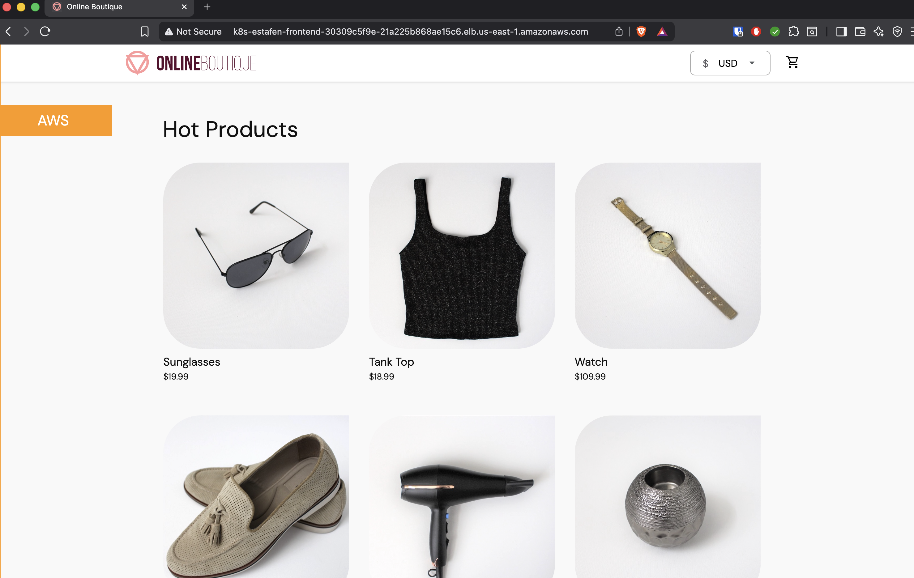

# Deployment Steps (Web Console)

This section walks you through the deployment using the AWS Management Console for cluster management.

## Step 1: Create IAM roles (one-time setup)

### 1.1: Create EKS cluster role

1. Go to AWS Console → Search "IAM" → Roles → "Create role"
2. Select "AWS service" → Choose "EKS" → Select "EKS - Cluster"
3. Click "Next" (permissions are pre-attached)
4. Role name: `eks-cluster-role`
5. Click "Create role"

### 1.2: Create EKS node role

1. IAM → Roles → "Create role"
2. Select "AWS service" → Choose "EC2"
3. Attach these 3 policies:
   - `AmazonEKSWorkerNodePolicy`
   - `AmazonEKS_CNI_Policy`
   - `AmazonEC2ContainerRegistryReadOnly`
4. Role name: `eks-node-role`
5. Click "Create role"

### 1.3: Fix trust policy for eks-cluster-role (Important!)

After creating the `eks-cluster-role`, you need to update its trust policy to support EKS Auto Mode:

1. IAM → Roles → `eks-cluster-role`
2. Click "Trust relationships" tab
3. Click "Edit trust policy"
4. Replace the content with:
```json
{
  "Version": "2012-10-17",
  "Statement": [
    {
      "Effect": "Allow",
      "Principal": {
        "Service": "eks.amazonaws.com"
      },
      "Action": [
        "sts:AssumeRole",
        "sts:TagSession"
      ]
    }
  ]
}
```
5. Click "Update policy"

**Why this is needed:** EKS Auto Mode requires the `sts:TagSession` action. Without this, you'll get an error when creating the cluster.

## Step 2: Create VPC for EKS (Optional but Recommended)

You can use your default VPC, but creating a dedicated VPC is better for production-like setups.

### Option A: Use default VPC (Simpler)
- Skip this step and use your existing default VPC in Step 3
- Good for: Testing, demos, learning

### Option B: Create dedicated VPC (Recommended)

1. Go to AWS Console → Search "VPC" → "Create VPC"
2. **VPC settings:**
   - Select: **"VPC and more"** (creates everything automatically)
   - Name tag: `estafen-eks-vpc`
   - IPv4 CIDR block: `10.0.0.0/16`
   - IPv6 CIDR block: No IPv6 CIDR block
   - Tenancy: Default
3. **Availability Zones and subnets:**
   - Number of Availability Zones: `2` (minimum required by EKS)
   - Number of public subnets: `2`
   - Number of private subnets: `2`
   - Customize subnet CIDR blocks: Leave defaults
4. **NAT gateways:**
   - Select: `In 1 AZ` (saves ~$32/month vs "1 per AZ")
   - Good for: Development/testing
   - For production: Use "1 per AZ" for high availability
5. **VPC endpoints:**
   - Select: `None` (or add S3 Gateway to optimize costs)
6. **DNS options:**
   - ✓ Enable DNS hostnames
   - ✓ Enable DNS resolution
7. **Additional tags** (click "Add new tag"):
   - Key: `kubernetes.io/cluster/estafen-cluster`
   - Value: `shared`
   - **Important:** This tag helps EKS discover and manage resources in the VPC
8. Click "Create VPC"
9. **Wait ~2-3 minutes** for VPC creation to complete

**What this creates:**
- 1 VPC with public and private subnets across 2 availability zones
- 1 Internet Gateway (for public subnet internet access)
- 1 NAT Gateway (for private subnet internet access)
- Route tables configured automatically
- Security groups ready for EKS

## Step 3: Create EKS cluster

1. Go to AWS Console → Search "EKS" → Click "Add cluster" → "Create"
2. **Configure cluster:**
   - Cluster name: `estafen-cluster`
   - Kubernetes version: 1.34
   - Cluster service role: Select `eks-cluster-role` (created above)
   - Click "Next"
3. **Specify networking:**
   - VPC: Select your default VPC
   - Subnets: Select at least 2 subnets in different availability zones
   - Security groups: Leave default
   - Cluster endpoint access: "Public and private"
   - Click "Next"
4. **Configure observability:**
   - Leave all unchecked (optional features)
   - Click "Next"
5. **Select add-ons:**
   - Keep defaults (CoreDNS, kube-proxy, vpc-cni)
   - Click "Next"
6. **Review and create:**
   - Review settings
   - Click "Create"
   - **Wait ~10-15 minutes** for cluster to be "Active"
   - The cluster needed to be upgraded to 1.35 version.






## Step 4: Understanding EKS Auto Mode (Node Management)

When you created the cluster with Kubernetes version 1.35, **EKS Auto Mode** was automatically enabled. This is a new feature that manages nodes for you.

### What you should see in the Compute tab:

**Auto Mode system nodes** (created automatically):
- 2 nodes with type `c6g.large` labeled "Auto Mode - system"
- These run Kubernetes system components (CoreDNS, kube-proxy, etc.)

**Auto Mode node groups**:
- `general-purpose` - For your application workloads
- `system` - For system workloads
- Both use the `eks-node-role`





## Step 5: Connect kubectl to your cluster

```bash
# Update kubeconfig to connect to your EKS cluster
aws eks update-kubeconfig --name estafen-cluster --region us-east-1

# Verify connection
kubectl get nodes
```

## Step 6: Deploy the Helm chart

```bash
# Navigate to your project directory
cd /Users/isidro/Documents/k8s-helm-estafen

# Deploy using AWS-specific values
helm install estafen . -n estafen --create-namespace -f values-aws.yaml

# Watch the pods start up
kubectl get pods -n estafen -w
```

## Step 7: Access the application

```bash
# Get the LoadBalancer URL (may take 2-3 minutes to provision)
kubectl get svc frontend-external -n estafen

# Copy the EXTERNAL-IP and open it in your browser
```

---

# Verify deployment

## Check nodes

```bash
kubectl get nodes
```


## Check pod status

```bash
# All pods should be "Running"
kubectl get pods -n estafen
```


## Check LoadBalancer

```bash
# Get LoadBalancer details
kubectl describe svc frontend-external -n estafen
```


## Final Application Status



---

## Cluster cleanup

All AWS resources (EKS Cluster, NAT Gateway, and VPC) were deleted after deployment to avoid unnecessary costs.

---

# Lessons Learned: AWS-specific fixes

During the AWS EKS deployment, several template and infrastructure adjustments were required to achieve a successful rollout.

### 1. Helm Chart Size Optimization
The initial deployment failed with a "Request entity too large" error (3MB limit).
- **Fix**: Updated `.helmignore` to exclude large media files (`*.mov`, `screenshots/`) and the `.git` directory, reducing the package size significantly. This .mov file was removed from the repository later.

### 2. Template Naming Standardization
A "nil pointer" error occurred because templates were looking for `serviceAccount` configuration under the plural key `serviceAccounts`.
- **Fix**: Standardized all microservice templates to use the singular `serviceAccount` key, aligning with the project's `_helpers.tpl` and industry standards.

### 3. Missing Global Configuration
The Helm templates required several variables that were missing from the configuration files.
- **Fix**: Added `namespace.name` and environment variables like `redisAddr` and `cymbalBranding` to `values.yaml` to ensure structural consistency across all environments.

### 4. Internet-Facing LoadBalancer
By default, the AWS Load Balancer was provisioned as "internal", making the site inaccessible from the public internet.
- **Fix**: Added `internet-facing` and `external` annotations to the `frontend-external` service template.

### 5. Persistent Storage Workaround
The EKS Auto Mode cluster had restricted IAM permissions (IMDSv2 hop limit/OIDC), causing the EBS CSI driver to crash and blocking the `redis-cart` pod.
- **Fix**: Switched Redis storage to `emptyDir` in `values-aws.yaml` to bypass the infrastructure constraints and enable a functional end-to-end deployment.

---


