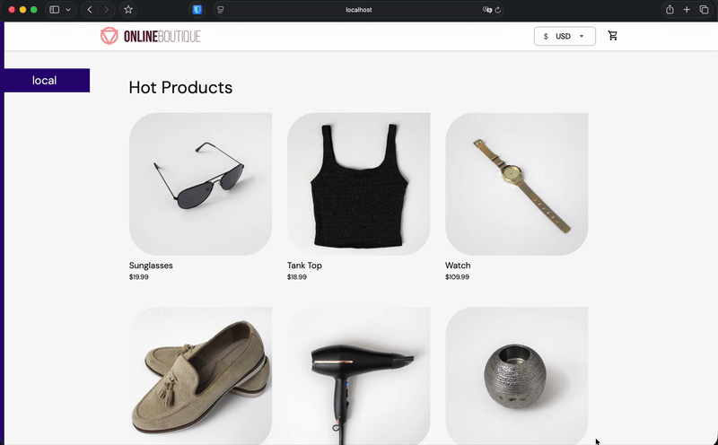
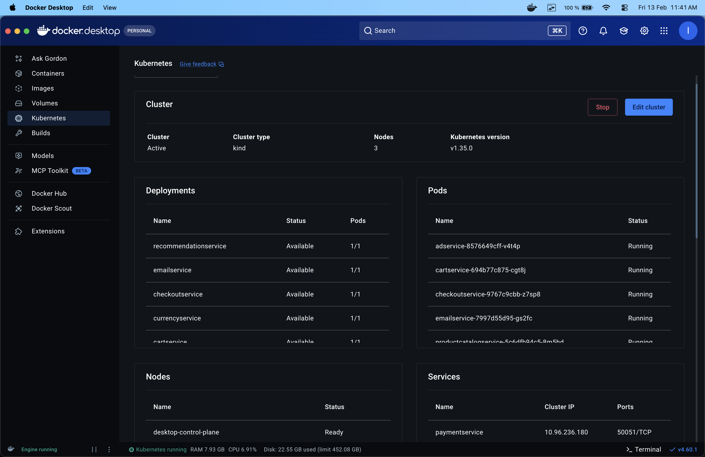
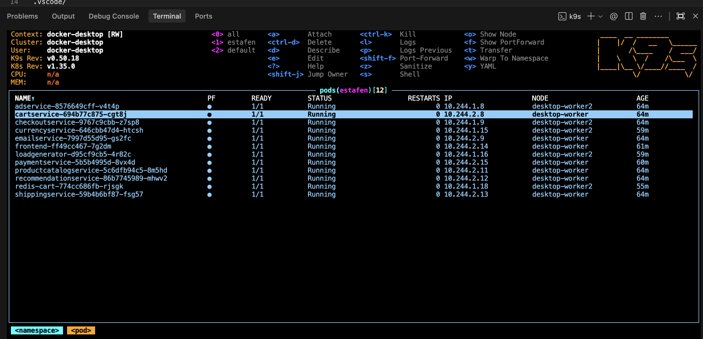

# Project: Online Boutique deployment on Kubernetes with Helm locally and in AWS EKS


This project documents my process of adapting and deploying Google's "Online Boutique" (a microservices demo application) into a local Kubernetes environment in Dockerhub Kubernetes using Helm and later into AWS EKS. You can find the detailed steps for the cloud setup in the [AWS EKS Deployment Guide](AWS_DEPLOYMENT_GUIDE.md).

The main goal was to take a complex microservices architecture (11 services + database) and build a custom Helm chart from scratch to deploy it efficiently on my local machine.

## About the application

I chose this application because it represents a real-world e-commerce scenario: it consists of a frontend in Go, cart service in C#, recommendation service in Python, payment service in Node.js, and more. All services communicate with each other via gRPC, making it perfect for testing Kubernetes orchestration. 

> [!NOTE]
> **About the name:** "Estafen" is the title of the first book by the renowned Argentine author Juan Filloy. I chose this name as a personal tribute to his literary legacy.

## Project demo & screenshots

Here is a quick demonstration of the application running locally:



### Dashboard & monitoring

**Docker Desktop dashboard:**


**Real-time monitoring with K9s:**



## What I did

Instead of using loose Kubernetes manifests, I decided to package everything into a Helm chart to have better control over the deployment.

1.  **Chart structure**: I organized the project in a modular way, with a dedicated template for each microservice and a unified global configuration.
2.  **Flexible configuration**: I made it easy to modify parameters like resources (CPU/RAM) or image versions without touching the template code.
3.  **Local adaptation**: I tweaked the configuration to ensure it works smoothly in a local environment like Kind or Docker Desktop, which has different constraints than a cloud environment (like GCP or AWS).

## Challenges I faced (and how I solved them)

During development, I encountered several interesting issues that I had to investigate and solve:

### 1. Images not downloading (ImagePullBackOff)

At first, nothing was working because the pods couldn't pull the images. I discovered that Docker Hub was having connection issues or rate limits with my local network.

**Solution:**
*   For Redis, I stopped using Docker Hub and switched to the Amazon Public ECR image, which downloaded without issues.
*   For the Google microservices, I pointed directly to Google's Artifact Registry (`us-central1-docker.pkg.dev`) instead of `gcr.io`, which was causing problems.
*   I modified the load generator configuration to use a lighter and more stable base image.

### 2. Frontend constant restarts

The frontend service would start and immediately crash. Checking the logs, I saw that the Go application was programmed to panic if a specific environment variable (`SHOPPING_ASSISTANT_SERVICE_ADDR`) was missing, even if that feature wasn't being used.

**Solution:** I injected a "dummy" variable into the configuration to bypass the strict check and allow the service to start correctly.

### 3. Conflicts with Google Cloud tools

Some services (like the payment service) tried to automatically connect to the Google Cloud Profiler. Since they had no credentials in my local environment, they failed.

**Solution:** I explicitly disabled these debugging tools via environment variables to force the services to run in "isolated" mode.

## Deployment

This chart supports multiple deployment environments through different values files:

### Local deployment (Docker Desktop / Kind)

```bash
# Deploy using default values.yaml (optimized for local)
helm install estafen . -n estafen --create-namespace

# Access the application
kubectl port-forward -n estafen svc/frontend-external 8080:80
# Open browser: http://localhost:8080
```

### AWS EKS deployment

```bash
# Deploy using AWS-specific configuration
helm install estafen . -n estafen --create-namespace -f values-aws.yaml

# Get the LoadBalancer URL (may take a few minutes)
kubectl get svc frontend-external -n estafen
# Access via the EXTERNAL-IP shown

For a complete walkthrough with screenshots of the AWS setup, check the [AWS EKS Deployment Guide](AWS_DEPLOYMENT_GUIDE.md).
```

**Key differences in AWS deployment:**
- Increased resource limits for production traffic
- LoadBalancer gets a real public IP
- Load generator disabled (no simulated traffic needed)

## Final result

I now have a functional chart that deploys the entire online store with a single command. It serves as a complete testing environment running locally and also in a Cloud environment.